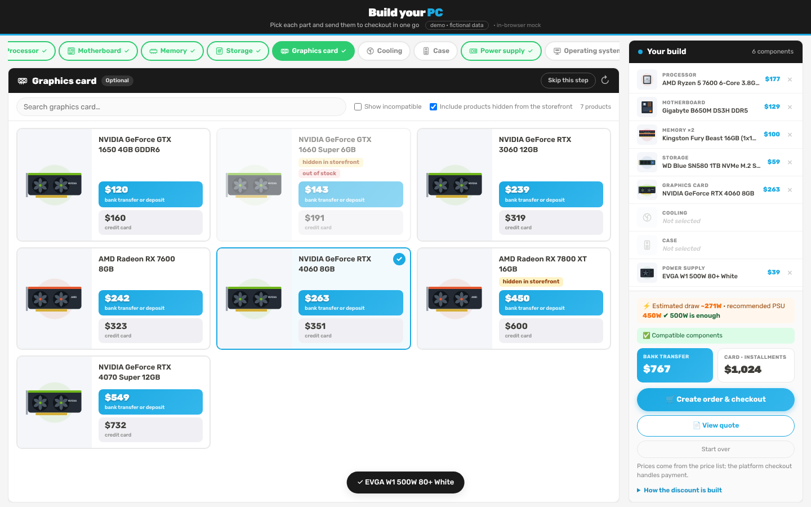
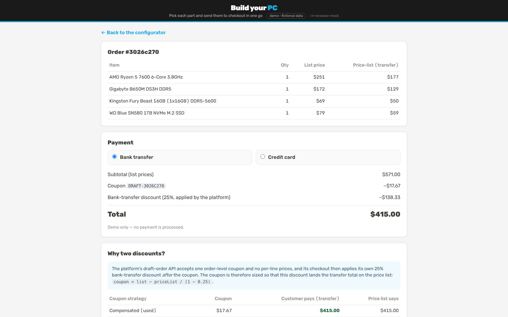
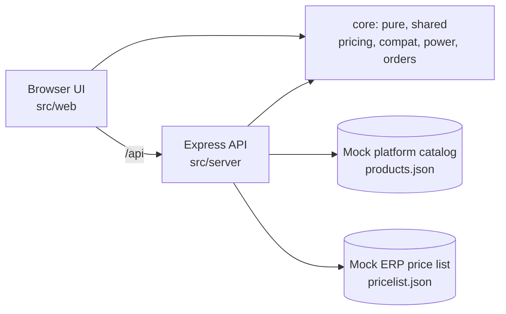

# PCForge

[](https://github.com/Franco12-stack/pcforge/actions/workflows/ci.yml)

A PC configurator that sells from a **wholesale price list** on top of a hosted e-commerce platform:
a compatibility engine, a pricing engine that works around the platform's limits, and a draft-order checkout.

**[Live demo](https://Franco12-stack.github.io/pcforge/)** (runs entirely in your browser, no backend) · [Español](#resumen-en-español)



## Why this exists

This is a clean-room, fictional-data re-implementation of a configurator I built for an e-commerce business.
The interesting part was not the UI: it was making a **hidden wholesale price list (from an ERP) show up correctly on a
platform that has no concept of it**, without ever charging a customer the wrong amount.

- The catalog lives on a hosted store platform; the special prices live in the ERP.
- The platform's draft-order API only accepts `product + quantity` per line and **one** order-level discount. There is no per-line price.
- On top of that, the platform applies its **own** bank-transfer discount automatically at checkout.

## Features

- **Full 12-step builder**: processor, motherboard, memory, storage, graphics, cooling, case, power supply, OS, connectivity, monitor and peripherals; optional steps can be skipped, multi-item steps take quantities, and picking a single part advances to the next step.
- **Product images**: every product gets a generated SVG illustration (no photo assets needed).
- **Quote view**: build a printable quote with both payment prices and download it as HTML.
- **Responsive**: sidebar on desktop, floating total bar plus drawer on phones.
- **Compatibility engine**: CPU/motherboard socket, DDR4 vs DDR5, with the LGA1700 special case (the board decides the memory type). Incompatible parts are hidden or disabled.
- **Power estimate and PSU recommendation**, with a warning when the chosen PSU is too small.
- **Wholesale pricing** shown live while building: bank-transfer price and credit-card price.
- **Hidden products**: items unpublished on the public storefront can still be sold through the configurator (as long as they have stock).
- **Server-authoritative orders**: the client only sends product IDs and quantities; prices are resolved on the server.
- **Two run modes** sharing the same core code: an Express API, or a fully static in-browser mode for GitHub Pages.



The checkout view simulates the platform: it applies its own transfer discount after the coupon and shows what a naive coupon would have charged.

## The interesting problem: pricing under platform constraints

### The bug

Say a product lists at **$1,000** and the price list says it should cost **$700** by bank transfer.
The obvious coupon is `list - price list = $300`. But the platform then applies its own 25% transfer discount *after* the coupon:

| Strategy | Coupon | Customer pays by transfer | Should pay |
|---|---|---|---|
| Naive: `list - priceList` | $300.00 | (1000 - 300) × 0.75 = **$525** | $700 |
| Compensated | $66.67 | (1000 - 66.67) × 0.75 = **$700** | $700 |

The discount is applied twice, so the customer is undercharged by exactly `rate × priceList`.
This is not hypothetical: it happened in production with a real order (the platform's discount was visible as a second line on the order),
which is why the project has a regression test for it.

### The fix

Size the coupon so that the platform's own discount lands the total on the price list:

```
(list - coupon) × (1 - rate) = priceList
coupon = list - priceList / (1 - rate)
```

See [`src/core/pricing.js`](src/core/pricing.js). A useful side effect: **paying by card (no platform discount) costs
`priceList / (1 - rate)`**, which is exactly the card price shown in the UI. Both payment methods land on the displayed prices.

### How it is tested

- Unit tests for the formula, the naive bug and the clamping case (list price already below target).
- A **property test** over 500 random carts asserting, for each: `transfer == Σ priceList` and `card == Σ priceList / 0.75`.
- A regression test for products **without** a price-list entry: they must keep their normal transfer price (list × 0.75), not the full list price.
- A server-side guard: if the client sends the total it was shown and prices changed meanwhile, the API answers `409 PRICE_CHANGED`.

### Rounding policy

Displayed prices always round **up**. The transfer price is the number the order is built on, and the card price derives from it,
so what is shown for card is never below what is charged (and within $1 per line).

## Compatibility engine

Catalog metadata is rarely complete, so detection is layered and **missing data never blocks a product**:

1. explicit attribute (`socket`, `ramType`)
2. socket / memory type written in the product name
3. inference from the chipset (`B450M` → AM4, `Z890` → LGA1851, …) or the CPU family (`Core Ultra` → LGA1851)

| Rule | Behavior |
|---|---|
| CPU ↔ motherboard | must share a socket (filtered both ways) |
| Memory | AM4/LGA1200 → DDR4, AM5/LGA1851 → DDR5; for **LGA1700** the motherboard decides |
| PSU | recommended = estimated draw × 1.3, rounded up to a real PSU size |

## Architecture



`src/core` has **zero dependencies and no I/O**: the same modules run on the server and in the browser, which is what makes the
static demo possible and keeps the business rules in one tested place.

## Run it

Requires Node 20+.

```bash
npm install
npm start            # http://localhost:3000  (server mode)
npm test             # 35 tests, built-in node:test runner, no test dependencies
npm run build:site   # static copy in ./site (what GitHub Pages serves)
```

Environment: `PORT` (default 3000), `NATIVE_TRANSFER_RATE` (overrides the platform's discount rate, default `0.25`).

### Publish the static demo

Push to `main`, then in the repo go to **Settings → Pages → Source: GitHub Actions**. The workflow in
`.github/workflows/pages.yml` runs the tests, builds `./site` and deploys it.

## API

| Method | Path | Description |
|---|---|---|
| GET | `/api/config` | currency and platform discount rate: single source of truth for UI and server |
| GET | `/api/products?category=&publishedOnly=` | admin view (includes hidden products); `publishedOnly=1` shows the public storefront |
| GET | `/api/prices?skus=a,b` | price-list entries; SKUs without one are omitted |
| POST | `/api/orders` | `{ items: [{ id, quantity }], expectedTransferTotal? }` → order with quotes for both payment methods |
| GET | `/api/orders/:id` | fetch an order |

Errors: `400` invalid input · `409` prices changed · `422` unknown product / out of stock · `404` not found.

## Project layout

```
src/core/     pure business logic (pricing, compat, power, orders)
src/server/   Express app + fictional data (products, price list, config)
src/web/      vanilla-JS UI: configurator, checkout view, product art, API layer (server or in-browser)
test/         unit, property and HTTP tests
scripts/      data generator and static-site builder
```

## Design decisions and trade-offs

- **Shared pure core instead of duplicating rules** in client and server. In the original project the discount rate lived in two places and had to be changed in both; here the UI reads it from `/api/config`.
- **The server never trusts client prices.** The original flow sent prices from the browser; here the client sends IDs and the server prices the order.
- **Vanilla JS, one runtime dependency (Express).** The point is the domain logic; a framework would only hide it.
- **Mock platform and ERP behind the same shapes as the real ones**, so swapping in real clients touches `src/server/app.js` only.

## Not production-ready, on purpose

In-memory orders, no auth, no real payments, fictional prices. Next steps would be real platform and ERP clients,
persistent order storage, retries/backoff around the external APIs, and a health check that verifies the dependencies.

## Resumen en español

Configurador de PCs que vende con una **lista de precios mayorista** (de un ERP) sobre una plataforma de e-commerce que no
soporta precios por línea. El problema central es matemático: la plataforma aplica su propio descuento por transferencia
*después* del cupón, así que un cupón ingenuo descuenta dos veces y cobra de menos. La solución dimensiona el cupón como
`lista − precioMayorista / (1 − tasa)`, de modo que transferencia y tarjeta caen exactamente en los precios mostrados.
Incluye motor de compatibilidad (socket, DDR4/DDR5), estimación de consumo, 35 tests (con test de propiedades) y un modo
estático que corre sin backend en GitHub Pages. Todos los datos son ficticios.

## License

MIT
